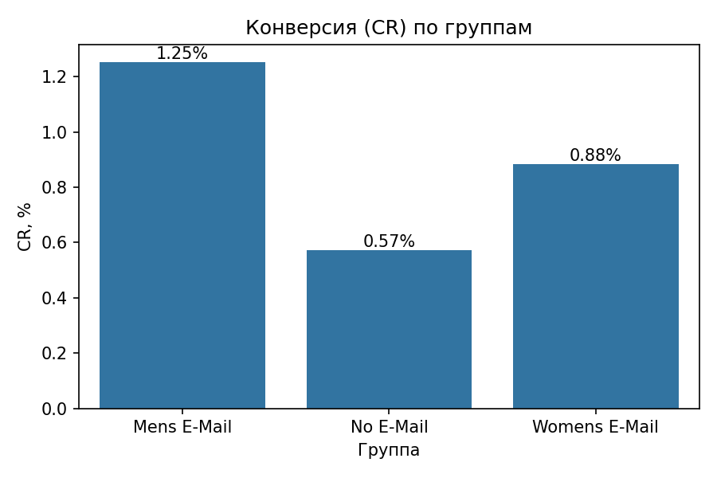
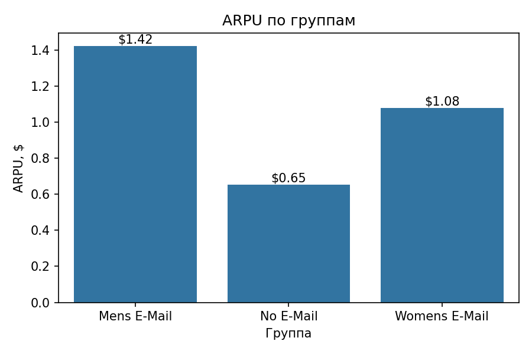

# Анализ A/B-теста email-рассылок

Учебный проект по анализу исторического эксперимента: сравнивается конверсия и выручка клиентов, получивших промо-письмо, с контрольной группой без письма.

## Данные и постановка задачи

В `data/hillstrom.csv` содержатся 64 000 наблюдений и 12 столбцов. В `segment` указана экспериментальная группа (`Mens E-Mail`, `Womens E-Mail` или `No E-Mail`), а `visit`, `conversion` и `spend` описывают результаты кампании. Данные также содержат признаки клиентов до рассылки, например давность и историю покупок, канал и регион.

**Источник.** Kevin Hillstrom, *MineThatData E-Mail Analytics And Data Mining Challenge* (2008):
https://www.kaggle.com/datasets/sumittarya/hillstrom-email-marketing

Сам CSV в репозиторий не включён: скачайте его по ссылке выше и положите в `data/hillstrom.csv`.

Основная метрика — конверсия (`conversion`). Дополнительно рассматриваются визиты и выручка на клиента (ARPU, столбец `spend`). Проверяются два отдельных сравнения: каждое письмо против контроля. Мужское и женское письма напрямую статистически не сравниваются, поэтому различие их точечных оценок само по себе не доказывает, что одно письмо лучше другого.

## Подход

- Проверены пропуски, согласованность `spend` и `conversion`, размеры групп и баланс признаков.
- Полные дубликаты не удаляются: в данных нет идентификатора клиента, поэтому одинаковые строки могут относиться к разным клиентам.
- Для конверсии использован двусторонний Z-тест для двух долей; для ARPU — тест Уэлча и bootstrap-интервалы.
- Для двух сравнений с контролем применена поправка Холма. Мощность оценивалась при 80%; расчёт MDE использует α = 0.025.
- Сегментный анализ носит поисковый характер. Его результаты рассматриваются как гипотезы для следующего теста, а не как подтверждение различий между сегментами.

## Основные результаты

В контрольной группе конверсия составила **0.57%**, ARPU — **$0.65**.
| Сравнение с контролем | Конверсия теста | Прирост конверсии | Прирост ARPU | Вывод |
|---|---:|---:|---:|---|
| `Mens E-Mail` | 1.25% | +0.68 п.п. (+119% относительно контроля) | +\$0.77 | Рост CR и ARPU значим (p_holm < 0.0001). При заданных допущениях рассылка окупается: ROMI 1.31, интервал прибыли целиком выше нуля |
| `Womens E-Mail` | 0.88% | +0.31 п.п. (+54%) | +\$0.42 | Рост CR и ARPU значим (p_holm = 0.00016 для CR, 0.0011 для ARPU). Окупаемость не гарантирована: ROMI 0.27, интервал прибыли включает ноль |





*Графики показывают точечные оценки без доверительных интервалов; значимость и интервалы приведены в таблице выше и в ноутбуке.*

## Ограничения

- Это историческая кампания; результаты нельзя автоматически переносить на текущую аудиторию или условия.
- Идентификатора клиента нет, поэтому нельзя проверить уникальность клиентов или корректно связать повторные записи.
- В данных нет защитных метрик, например отписок и жалоб на спам.
- Стоимость письма и маржа — допущения, а не значения из датасета.
- Для доказательного выбора между мужским и женским письмом нужен отдельный прямой тест.

## Структура проекта

```text
.gitignore
requirements.txt
data/            (CSV не хранится в репозитории, см. «Данные»)
notebooks/
  01_analysis.ipynb
reports/
  arpu_by_group.png
  cr_by_group.png
```

## Запуск

Проверенная среда — Python 3.12. Для установки зависимостей из корня проекта:

```bash
python3.12 -m venv .venv
source .venv/bin/activate
python -m pip install -r requirements.txt
cd notebooks
jupyter lab 01.ipynb
```

Запускайте ноутбук из папки `notebooks`: путь к CSV в нём задан как `../data/hillstrom.csv`. Чтобы пересчитать результаты, выполните ячейки ноутбука сверху вниз.
